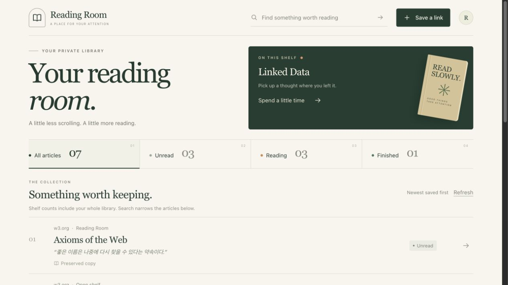

# Reading Room 문서

Reading Room은 원본 Linkwarden에 개인 읽기 상태와 한 줄 감상을 더한 제품이다. 공유 링크와 개인 기록의 소유권을 분리하고, 원본의 실제 저장·보존·읽기 경로를 사용한다.

이번 rebuild의 실제 계정과 7개 링크를 사용한 production 화면이다. 브라우저 viewport는 1280×720이고 content scrollWidth는1265였다.

- [원본 대비 변경과 요구·검토·커밋 추적](original-vs-reading-room.md)
- [로컬 실행·종료·재검증](run-local.md)
- [AS-IS 원본 내부 코드 분석](design/2026.10.25/as-is/system-design-as-is.md)
- [TO-BE JobFlow·Navigation·Layout](design/2026.10.25/to-be/system-design-to-be.md)
- [독립 프론트엔드 프로토타입과 디자인 결정](design/2026.10.25/prototype.md)
- [실제 API 계약과 구현 차이](design/2026.10.25/real-contract.md)
- [최종 실제 함수·callback·Prisma 호출 지도](design/2026.10.25/final/source-map.md)
- [실행 검증·실패와 수정·남은 범위](design/2026.10.25/verification.md)
- [단계별 근거와 가이드 수정 반복](design/2026.10.25/_evidence-brief.md)

원본 화면은 [이번 fixture의 Dashboard](screenshots/as-is/dashboard.jpg)이며 프로토타입 캡처는 prototype 문서에 있다. 실제 제품의 [모바일 감상](screenshots/actual/mobile-note.jpg)은 production 390×844 iframe, [충돌 비교](screenshots/actual/conflict.jpg)와 [보존 원문](screenshots/actual/preserved.jpg)은 실제 개발 서버에서 캡처했다. [뷰어 글꼴 메뉴](screenshots/actual/viewer-menu.jpg)는 마지막 markup 수정 후 production에서 확인했다.
