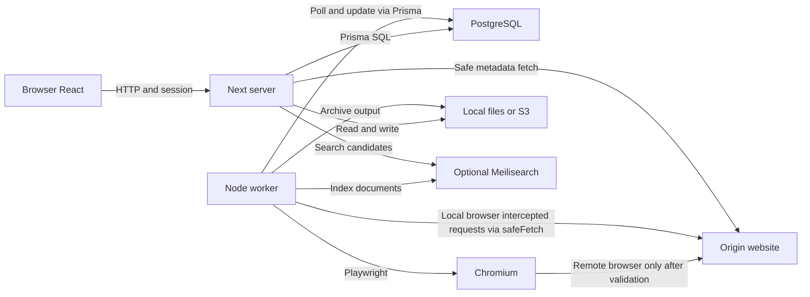

# 시스템 구성 — AS-IS

> 기준일: 2026.10.25 · 원본 소스: `952ac4540657cae3a67c3ca59433899d2fda8374` · 범위: 웹의 링크 저장·조회·공유와 보존 worker. 아래는 소스·설정에서 확인한 구성이다. 서버를 실행해 관찰한 배포 구성으로 주장하지 않는다.

[핵심 설계](../system-design-as-is.md) · [패키지 구성](package-configuration.md) · [Browser](browser.md) · [Web API](web-api.md) · [Worker](worker.md) · [공유 adapter](adapters.md)

## 1. 실행 단위와 통신

브라우저의 React 화면과 Next 서버는 같은 소스 패키지에서 만들어지지만 실행 장소가 다르다. 보존 worker는 별도 Node 프로세스이며, HTTP 저장 요청이 worker를 직접 호출하지 않는다. Web과 worker가 같은 PostgreSQL의 Link 상태를 읽고 쓰는 방식으로 연결된다.

이는 배포·통신 구성도다. 기본 local browser의 네트워크 요청은 `protectPageRequests`가 가로채 **Node worker의 safeFetch → route.fulfill**로 처리한다(`apps/worker/lib/protectPageRequests.ts:39–60`). 원격 browser 설정에서만 검증 후 `route.continue()`로 브라우저 요청을 진행한다(:27–36). 단계별 호출 관계는 [링크 저장](jobflow/save-link.md)과 [링크 보존](jobflow/preserve-link.md)의 Job Flow에서 연다.

| 실행 단위 | 책임·공개 접점 | 조립 근거 | 실패가 미치는 범위 |
|---|---|---|---|
| Browser | 입력·화면 이동·session 표시·TanStack query cache. 동일 origin API 요청 | `apps/web/pages/_app.tsx:18,49–54,78–109`; page·component와 `packages/router` hooks | cache/화면 변경은 DB transaction이 아니다. HTTP 실패 rollback은 [Browser JF-1.2](browser.md#jf-12-낙관적-쓰기와-결과-반영--useaddlink-callbacks) |
| Next server | Pages Router 화면/SSR와 `/api/v1/*` handler, 인증·권한·영속 쓰기·보존물 제공 | `apps/web/pages/api/`, `apps/web/lib/api/`; `apps/web/package.json`의 dev/start/build | 저장 응답과 보존 완료는 다른 사실. 인증 없는 공개 경로도 별도 권한 검사가 필요하며 화면 가드는 API 권한 검사를 대신하지 않음 |
| Worker supervisor | 개발·workspace start에서 자식 worker 실행, 자식 exit 후 5초 뒤 재실행 | `apps/worker/index.ts:3–23` | 이 supervisor는 Docker의 기본 CMD에서 사용하지 않음. 아래 §2 참조 |
| Worker body | migration 확인 후 RSS·보존·AI tagging·색인 루프 시작 | `apps/worker/worker.ts:11–22` | 루프별 실패 정책과 개별 archive 실패 회수는 [Worker](worker.md). 다른 루프가 같은 process와 DB client를 사용 |
| Chromium | 원문 탐색·DOM 추출·capture의 외부 런타임 | `apps/worker/lib/browser.ts:53–60` | 기본은 local launch와 worker의 요청 중계. `PLAYWRIGHT_WS_URL`이 있으면 원격 CDP에 연결. URL 검증·context 수명은 [Worker](worker.md)·[adapter](adapters.md) |
| Monolith child | 해당 보존 형식이 선택됐을 때 HTML을 처리하는 별도 CLI 자식 프로세스 | `apps/worker/lib/preservationScheme/handleMonolith.ts:35`의 spawn | worker와 항상 함께 뜨는 서버가 아님. 호출자가 전달한 AbortSignal을 spawn에 연결(:37–38)하며 종료 결과·출력 파일 처리는 format handler가 맡음(:60–94) |
| PostgreSQL | 계정·collection·link·보존 경로/상태의 영구 데이터 | `packages/prisma/schema.prisma:5–8` | Web/worker가 각각 PrismaClient를 사용. 같은 DB를 쓴다고 요청 전체가 하나의 transaction이 되지 않음 |
| Files | 저장된 보존물·업로드 파일. 설정에 따라 local filesystem 또는 S3 | `packages/filesystem/` | 파일과 DB는 별도 쓰기. `createFile` 실패 반환과 DB 경로 기록의 차이는 [adapter S-01](adapters.md#8-이슈) |
| Meilisearch | 선택적 검색 색인. PostgreSQL이 권한·Link 원본 | `packages/lib/meilisearchClient.ts:3–10`, `apps/worker/workers/linkIndexing.ts:63–66` | key가 없으면 client=null, indexing 함수는 반환. key가 있는 경우 색인 지연/실패를 원본 DB 성공과 혼동하지 않음 |

## 2. 기동·종료와 수명

| 실행 방식 | 실제 순서 | 책임 경계·한계 |
|---|---|---|
| 개발 | root `concurrently:dev`가 dotenv를 거쳐 web의 `next dev`와 worker의 `tsx watch index.ts` 실행 | `package.json`과 각 app scripts. 개발 watcher·supervisor가 존재하는 구성이며 Docker와 동일하다고 간주하지 않음 |
| workspace start | root `concurrently:start` → `next start` / `tsx index.ts`; index의 `launch`가 현재 Node로 `tsx/cli worker.ts` spawn | `apps/worker/index.ts:7–17`: 모든 child exit에 재시작 예약. SIGINT handler는 supervisor의 `process.exit()`만 명시(:21). SIGTERM 전달·graceful drain을 이 파일이 보장한다고 쓰지 않음 |
| Docker image | Prisma schema migration 성공 → `concurrently -k` → web `next start`와 **직접** `tsx worker.ts` | `Dockerfile:99`. index supervisor를 거치지 않으므로 자식 재시작 5초 규칙이 적용되지 않음. `-k`와 compose의 `restart: always`가 별도 수명 정책 |
| worker body | `init` → `await migrationWorker()` → RSS/보존/tag/indexing 함수 시작 | `apps/worker/worker.ts:11–19`. 각 루프를 await하여 순서대로 완료시키는 구조가 아님. trial-end email 호출은 주석 상태 |
| migration | appMigration 상태 조회 후 등록된 migration 실행 | `apps/worker/workers/migrationWorker.ts:9–64`; 기준 소스의 `migrations` 배열은 실제 항목 없이 주석 예시만 있음(:73–80). DB schema migration과 별개 |
| 보존 browser 수명 | 기본 on-demand: 처리할 링크가 있을 때 확보, idle 60초 및 최대 age 30분 정책 | `apps/worker/workers/linkProcessing.ts:9–15,112–176`. persistent 분기는 시작 때 launch(:74–109). 성공한 browser 재사용을 매 요청 신규 launch로 그리지 않음 |

Dockerfile은 Node `22.23-bookworm-slim`, Monolith `2.10.1`, Chromium headless shell 설치를 지정한다(`Dockerfile:5,11,50,78–85`). 이 값은 소스 설정이다. compose의 `ghcr.io/linkwarden/linkwarden:latest`가 이 커밋과 동일한 이미지라는 증거는 없으므로, 현재 AS-IS 분석의 실행 증거로 사용하지 않았다.

Docker healthcheck는 `/`의 HTTP 성공만 확인한다(`Dockerfile:91–95`). DB 쓰기·worker 처리·모든 보존 형식·색인 완료를 검증하지 않는다. compose의 `depends_on` 목록에도 DB 준비 상태를 기다리는 health 조건은 없다(`docker-compose.yml`).

## 3. 저장소·설정·외부 의존

| 설정·저장소 | 선택·기본값 | 실제 소비자·중요한 차이 |
|---|---|---|
| `DATABASE_URL` | PostgreSQL 연결 | Prisma schema datasource. Prisma instance는 프로세스별 생성, 개발에서는 global 재사용(`packages/prisma/index.ts:3–14`) |
| `STORAGE_FOLDER` | 미설정 시 상대 경로 `data` | filesystem 함수의 현재 작업 디렉터리를 기준으로 해석. Web과 worker를 다른 cwd에서 실행할 때 같은 폴더라고 가정하면 안 됨. `createFolder.ts:9`, `createFile.ts:50`, `readFile.ts:81` |
| `SPACES_ENDPOINT/REGION/KEY/SECRET` | 네 값이 모두 있어야 S3 client 생성 | `s3Client.ts:3–18`. bucket 선택은 파일 함수의 `SPACES_BUCKET_NAME`; filesystem adapter 계약에 따라 읽기/쓰기. secret 값은 문서에 넣지 않음 |
| `MEILI_MASTER_KEY`, `MEILI_HOST` | key 없으면 미사용, host 기본 `http://meilisearch:7700` | `packages/lib/meilisearchClient.ts:3–10`; Web 검색과 worker index가 같은 설정을 소비 |
| `ARCHIVE_SCRIPT_INTERVAL` | 숫자 변환 결과가 falsy이면 10초 | `worker.ts:8–9`. 큐 메시지 전달이 아니라 DB polling 간격 |
| `ARCHIVE_TAKE_COUNT`, `BROWSER_LIFECYCLE` | 5, `on-demand` | `linkProcessing.ts:9–15`. 공정 선택의 구체 조건과 실패 후 재선택은 [Worker](worker.md) |
| 원문 웹·선택적 proxy | 입력 URL에 대한 외부 HTTP | API metadata fetch와 worker browser/format 처리에서 사용. 기본 SSRF 검사와 redirect/연결 시 검증은 [adapter](adapters.md) |
| SMTP·SSO·AI·Stripe | 관련 설정이 있을 때 해당 기능 경로에 영향 | 관련 소스는 `packages/lib/transporter.ts`, web auth 설정, worker auto-tagging, web billing. 이번 개인 링크·독서 과업 밖의 유료 구독/관리자 운영 전체를 분석 완료로 세지 않음 |

기본 compose는 PostgreSQL16 Alpine·Meilisearch1.13.3·app 세 서비스를 선언하고, 각각 `pgdata`, `meili_data`, `data` volume을 둔다. 이는 구성 파일의 사실이며 실제 데이터/컨테이너를 생성·변경한 기록이 아니다.

## 4. 검증과 한계

- 소스에서 entrypoint·spawn·loop 시작·Prisma 생성·storage 선택·compose 설정을 대조했다. Docker 또는 제품 실행 검증은 이 문서 작성 시 수행하지 않았다.
- 개별 업무의 성공·부분 실패·재시도는 소유 경계 문서가 원본이다. 구성도 하나로 내부 Job Flow 분석을 대체하지 않는다.
- 컨테이너 signal 전달, 실제 process 종료 시간, 장애 시 재시작, 선택적 외부 서비스 연결은 소스 설정과 실제 운영 관찰을 구분해야 한다.
