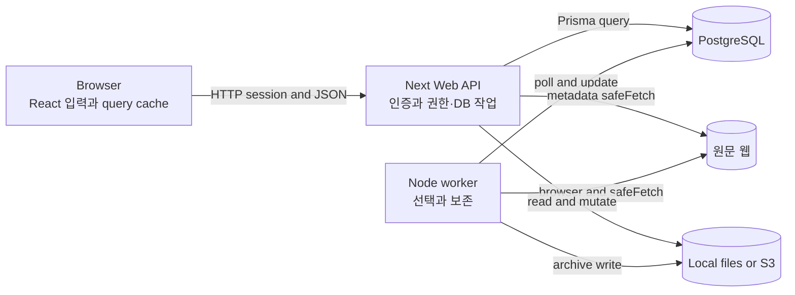

# Reading Room의 원본 Linkwarden — AS-IS 시스템 설계서

> **DATE** 2026.10.25 · **기준 커밋** `952ac4540657cae3a67c3ca59433899d2fda8374`(2026-09-09T20:12:04-04:00·upstream PR1834), 새 포크의 소스 변경 없음
> **범위** 웹 인증·링크 목록/저장/상세/편집/삭제·collection 공유·공개 읽기·보존 worker·보존물과 개인 highlight. 독립 결제·관리·bulk·mobile 업무는 제외([브리프 §1](../_evidence-brief.md))
> **근거** 새 checkout의 선언·호출 위치·조건·쓰기·오류 수신자 역추출 → [브리프](../_evidence-brief.md), 상세는 [§8](#8-상세근거-인덱스와-한계)
> **표기** 구성은 Mermaid flowchart, 협력은 jobflow, 소유 상태는 state, 화면 이동은 navigation, 배치는 layout. 가이드 파일명은 system-design-document-guide.md와 각 DSL guide를 따른다.
> **원칙** 현재 코드를 그대로 설명하고 결함은 이슈 ID로 기록한다. 개인 읽기상태와 링크별 한줄감상은 현재 구현으로 가정하지 않는다.
> **공통 한계** 전체 AS-IS의 소스 의미·범위 게이트를 독립 Critic과 부모 검토자가 통과시켰다. 서버·DB·브라우저는 아직 띄우지 않았으며 런타임 서술은 코드상 예상이다.

## 0. 한눈에 보기



**범례** 실선은 런타임 호출이다. Web과 worker 사이 직접 작업 발행 선은 없다.

**요지**
- 링크 저장과 보존은 DB marker로 연결된 다른 업무 완료다. 저장 200은 원문 복제 완료가 아니다. A-02/W-01.
- 링크 metadata와 collection 권한은 공유 데이터다. 현재 schema에는 사용자와 링크별 읽기 상태·한 줄 감상 모델이 없다. A-09.
- UI mutation의 낙관적 cache와 실제 DB/file 결과는 다른 수명이다. 창이 먼저 닫힌 뒤 서버 오류가 도착할 수 있다. B-01.
- worker finally와 setup 실패의 위치가 자동 재선택 여부를 바꾼다. 파일·DB 쓰기는 한 transaction이 아니다. W-03/S-01.

## 1. 핵심 용어

| 용어 | 뜻 | 원본 |
|---|---|---|
| Link | URL·공유 description/tags·보존 경로를 가진 저장물 | schema.prisma:168, [API](details/web-api.md) |
| Collection/member | owner와 canCreate/canUpdate/canDelete가 있는 공유 단위 | schema:128/153, API JF-1.2.1/8 |
| lastPreserved | worker selector의 null 기준과 시도 완료 marker | archiveHandler:219, [Worker](details/worker.md) |
| unavailable | 형식 경로 대신 저장하는 생성 불가 표식 | archiveHandler:220–224 |
| Readable/Monolith | 정제 JSON 읽기 본문/단일 HTML 보존 형식 | Worker format handler |
| Highlight | user/link/text offsets에 붙는 색·comment. 링크별 reflection과 다름 | schema:276, API JF-12 |
| L0/L1/L2 | 경계 계약 요약/실제 내부 협력/복잡한 협력자 추가 확대 | 각 시나리오의 내부 추적표 |
| callback | 등록 후 React/TanStack/Node 등이 실행하는 함수 | Browser·Adapter의 등록/실행 구분 |

## 2. 기능 — 무엇을 해주나

**결론**: 현재 제품은 링크를 모으고 공유·보존하여 다시 읽는 도구이며 개인 독서 단계는 아직 제공하지 않는다.

| 사용자·업무 결과 | 트리거 | 책임 경계 |
|---|---|---|
| 계정과 접근 세션 | 가입·로그인·재설정 | Browser/API/Auth |
| 허용 링크 탐색 | route 진입·검색·sort·scroll | Browser/API/Prisma |
| URL 저장·정보 변경·삭제 | 폼과 메뉴 | Browser/API/Files |
| collection 공유 | owner의 공유 저장 | API와 membership DB |
| 원문 보존 | worker poll | Worker/network/Files |
| 보존물 읽기와 선택범위 주석 | format·highlight 동작 | Browser/API/Files |

**기능 트리와 소유 모듈**(PBS 관점): 접근은 pages/auth와 auth API, 개인 library 입력은 pages/links·components·router hooks, shared link/collection 정책은 web controllers, preservation은 worker와 filesystem/lib adapter로 묶인다. 읽기상태와 한줄감상은 이 트리에 없는 신규 요구다.

## 3. 구조

**결론**: Browser·Web API·Worker가 각자 상태를 소유하고 shared adapter를 호출한다. 프로세스 경계와 소스 package 경계는 다르다.

| 경계 | 포트·형태 | 한 줄 책임 | 공개 진입점 | 소유 상태 | 나가는 의존 |
|---|---|---|---|---|---|
| [Browser](details/browser.md) | browser runtime | 입력·표시·캐시 | page/React event/query callback | React/TanStack/localStorage | Web HTTP |
| [Web API](details/web-api.md) | Next HTTP | 인증·공유 권한·영속 업무 | /api/v1, /api/v2 | DB rows·token | Prisma/Files/SMTP/SSO/원문 |
| [Worker](details/worker.md) | Node process | DB선택·보존·정리 | init/loop/archiveHandler | browser/context·format DB fields | Prisma/Chromium/Monolith/Files/원문 |
| [Adapter](details/adapters.md) | shared module | URL/DNS·파일IO 계약 | safeFetch/filesystem 함수 | 파일과 요청 수명 | DNS/HTTP/fs/S3 |

[시스템 구성](details/system-configuration.md)과 [패키지 구성](details/package-configuration.md)은 실행·배포·공개 진입·허용 의존을 별도 설명한다.

### 3.1 의존 방향에서 드러나는 사실

- API의 postLink는 worker/큐를 호출하지 않는다. worker는 null marker를 독립적으로 읽는다. A-01.
- Browser의 permission 표시는 API의 caller별 접근 조건을 대신하지 않는다. A-05.
- 파일 IO가 boolean 또는 callback으로 실패를 숨겨 DB 성공과 달라질 수 있다. S-01/S-03.
- collection의 transaction callback도 전역 Prisma를 사용하면 원자성을 의미하지 않는다. A-07.

## 4. 경계별 기능 목록

**결론**: 시작점과 조율자를 구분하면 저장·보존·조회 실패가 어디로 돌아가는지 따라갈 수 있다.

### 4.1 Browser (React)

| 기능 | 내용 | 진입점 |
|---|---|---|
| 접근 폼 | 로그인·가입·복구 | loginUser/registerUser/submitRequest/submit |
| 링크 작업 | query·낙관적 mutation·overlay | useLinks/useGetLink/useAddLink/useUpdateLink/useDeleteLink |
| 읽기·주석 | format선택·파일로딩·highlight | PreservationContent/ReadableView/HighlightDrawer |

### 4.2 Web API (Next HTTP)

| 기능 | 내용 | 진입점 |
|---|---|---|
| 인증 | credentials/email/JWT와verifyUser | auth handler/provider callbacks |
| library | 접근가능query·linkCRUD | search/links handlers |
| 공유 | owner-onlycollection변경/public읽기 | collections/public handlers |
| 보존물 제공 | 직접파일·서명URL·개인주석 | archives/preserved/highlights handlers |

### 4.3 Worker (Node)

| 기능 | 내용 | 진입점 |
|---|---|---|
| 기동 | appmigration뒤작업루프시작 | worker.init |
| 선택·처리 | 사용자별batch·browser수명 | linkProcessing/getLinkBatchFairly/processBatch |
| 보존 | request보호·형식생성·finallymarker | archiveHandler |

### 4.4 Adapter (공유 package)

| 패키지 | 기능 |
|---|---|
| lib | SSRF URL/DNS검사와safeFetch redirect |
| filesystem | local/S3 file읽기·쓰기·이동·삭제 |
| prisma | PrismaClient조립, query정책은caller소유 |

## 5. 흐름

**결론**: 대표 저장은 사용자 Create로 시작해 DB 응답으로 끝난다. 후속 보존은 worker poll이라는 별도 트리거이며 저장 응답을 보존 완료로 해석하지 않는다.

### 5.0 표기

L0의 Browser 동작·API 계약은 시나리오에서 실제 심볼로 매핑한다. receiveSave는 원 요청자의 다음 동작 예외 노드이며 API가 React callback을 직접 실행한다는 뜻이 아니다.

| 객체 | 경계 | 객체 | 경계 |
|---|---|---|---|
| Browser | React | API | Next HTTP |
| Worker | Node 실행 | ContentHost | 같은 Next의 보존용 host |

### 5.1 전체 한 장

```jobflow
scope: save_overview
Object: Browser, API
Browser.submitLink --> API.postLink
API.postLink.success --> Browser.receiveSave
API.postLink.failure --> Browser.receiveSave
```

**읽는 법**: 사용자가 저장을 요청하면 API가 검증·DB 쓰기·응답을 맡고, Browser의 mutation callback이 결과를 반영한다. Object 순서는 요청과 응답을 읽기 쉽게 Browser→API로 정했다.

[저장 계약·전수 노드 추적](details/jobflow/save-link.md#3-내부-추적)에서 NewLinkModal.submit→useAddLink→links→postLink→setCollection/capacity/metadata/Prisma/filesystem을 펼친다. worker는 이 그림의 후속호출이 아니라 아래 독립 시나리오다.

| § | 시나리오 | 트리거 | 완료 사실 | Job Flow | Navigation |
|---|---|---|---|---|---|
| [5.2](#52-링크-저장) | 링크 저장 | NewLink Create | DB link 생성과200응답; 보존은 미완료 | [save-link](details/jobflow/save-link.md) | [save-link](details/navigation/save-link.md) |
| [5.3](#53-로그인과-기본-진입) | 로그인과 기본 진입 | 비인증 사용자가 Login의 credentials form을 제출 | JWT session을 받은 뒤 AuthRedirect가 공개/구독/onboarding/보호 경로 조건에 맞는 화면을 표시 | [access](details/jobflow/access.md) | [access](details/navigation/access.md) |
| [5.4](#54-회원-가입) | 회원 가입 | Register의 Sign up form 제출 | User와 기본 dashboard sections가 생성되고 email설정에 따라 confirmation 또는 login으로 이동 | [register](details/jobflow/register.md) | [register](details/navigation/register.md) |
| [5.5](#55-재설정-이메일-요청) | 재설정 이메일 요청 | Forgot form에 이메일을 넣고 Send reset link 클릭 | 200을 받은 UI가 sent 안내를 표시; SMTP 전달 완료는 이 응답의 보장이 아님 | [request-reset](details/jobflow/request-reset.md) | [request-reset](details/navigation/request-reset.md) |
| [5.6](#56-재설정-토큰-소비) | 재설정 토큰 소비 | 메일의 `/auth/reset-password?token=...`에서 새 비밀번호 제출 | User.password가 갱신되고 token만료 처리 뒤 UI에 성공 문구와 Login 링크 표시 | [reset-password](details/jobflow/reset-password.md) | [reset-password](details/navigation/reset-password.md) |
| [5.7](#57-목록검색대시보드-조회) | 목록·검색·대시보드 조회 | 보호 목록/검색/collection route 진입 또는 sort/filter/스크롤 변화 | 허용 collection의 link page가 표시되고 nextCursor가 있으면 추가 페이지를 가져온다 | [browse-links](details/jobflow/browse-links.md) | [browse-links](details/navigation/browse-links.md) |
| [5.8](#58-링크-상세-조회) | 링크 상세 조회 | 카드의 info를 누르거나 `/links/[id]` 직접 진입 | 허용된 link의 제목·공유 description/tags·보존 형식이 상세 page/drawer에 표시 | [inspect-link](details/jobflow/inspect-link.md) | [inspect-link](details/navigation/inspect-link.md) |
| [5.9](#59-링크-편집) | 링크 편집 | 권한 있는 사용자가 LinkDrawer Edit에서 필드를 바꾸고 Save | DB link metadata가 갱신되고 query가 무효화된다. UI는 요청 완료 전에 view로 전환 | [edit-link](details/jobflow/edit-link.md) | [edit-link](details/navigation/edit-link.md) |
| [5.10](#510-링크-삭제) | 링크 삭제 | Delete confirmation의 Delete 또는 권한 있는 메뉴에서 Shift+Delete | DB link가 삭제되고 cache에서 제거된다. 파일 삭제 완료는200의 보장이 아님 | [delete-link](details/jobflow/delete-link.md) | [delete-link](details/navigation/delete-link.md) |
| [5.11](#511-컬렉션-공개회원-권한-변경) | 컬렉션 공개·회원 권한 변경 | 컬렉션 owner가 Sharing dialog에서 공개/회원/역할을 바꾸고 Save | 공개 flag와 root 회원 관계가 저장되고 dialog가 닫힌다. 선택하면 하위 회원관계도 순차 변경 | [share-collection](details/jobflow/share-collection.md) | [share-collection](details/navigation/share-collection.md) |
| [5.12](#512-공개-링크와-컬렉션-읽기) | 공개 링크와 컬렉션 읽기 | 공유 `/public/collections/:id` 또는 `/public/links/:id` URL 직접 진입 | isPublic collection에 속한 link 목록·상세와 공개 team정보 표시 | [view-public](details/jobflow/view-public.md) | [view-public](details/navigation/view-public.md) |
| [5.13](#513-보존-다시-생성-요청) | 보존 다시 생성 요청 | LinkDrawer/Preserved 메뉴에서 Refresh 확인 | format/lastPreserved가 null로 reset되어 worker poll 대상이 된다; 아직 파일 재생성 완료가 아님 | [refresh-preservation](details/jobflow/refresh-preservation.md) | [refresh-preservation](details/navigation/refresh-preservation.md) |
| [5.14](#514-선택-범위-highlight주석) | 선택 범위 highlight·주석 | Readable에서 텍스트 선택 후 색상/댓글 저장 또는 주석 삭제 | 개인 user/link/offset 주석이 저장되고 해당 highlight cache와 DOM표시 갱신 | [highlight](details/jobflow/highlight.md) | [highlight](details/navigation/highlight.md) |
| [5.15](#515-보존물-읽기) | 보존물 읽기 | 상세에서 형식을 선택하거나 preserved URL 직접진입 | 형식별 파일이 iframe/img/Readable 본문에 표시 | [read-preserved](details/jobflow/read-preserved.md) | [read-preserved](details/navigation/read-preserved.md) |
| [5.16](#516-백그라운드-보존) | 백그라운드 보존 | worker poll에서 lastPreserved=null link 선택 | format path 또는 unavailable와 lastPreserved 기록 | [preserve-link](details/jobflow/preserve-link.md) | [preserve-link](details/navigation/preserve-link.md) |
| [5.17](#517-메일-인증-링크-소비) | 메일 인증 링크 소비 | 메일 URL 열기 | web callback 또는 native 선택 UI | [Job Flow](details/jobflow/verify-email-link.md) | [Navigation](details/navigation/verify-email-link.md) |
| [5.18](#518-화면-초기-데이터-읽기) | 화면 초기 데이터 읽기 | 각 hook mount | user/config/collections cache와 가드 입력 | [Job Flow](details/jobflow/initial-data.md) | [Navigation](details/navigation/initial-data.md) |
| [5.19](#519-보존-본문-표시-설정) | 보존 본문 표시 설정 | TextStyle 선택 | User preference와 reader 표시 | [Job Flow](details/jobflow/reader-preference.md) | [Navigation](details/navigation/reader-preference.md) |

### 5.2 링크 저장

Create는 요청을 시작한 뒤 바로 창을 닫는다. API의 200은 링크 저장 완료이며 보존 완료는 아니다. [Job Flow](details/jobflow/save-link.md) · [Navigation](details/navigation/save-link.md)

### 5.3 로그인과 기본 진입

로그인 성공 후 AuthRedirect가 세션과 구독·이름·현재 경로를 판단한다. 이메일 미인증은 메일 안내로 분기하고, 원래 보호 URL을 보존하는 복귀 인자는 없다. [Job Flow](details/jobflow/access.md) · [Navigation](details/navigation/access.md)

### 5.4 회원 가입

가입은 User와 기본 dashboard sections를 생성한다. 중복·등록 차단 오류는 폼에 남고, 성공하면 이메일 설정에 따라 Confirmation 또는 Login으로 이동한다. [Job Flow](details/jobflow/register.md) · [Navigation](details/navigation/register.md)

### 5.5 재설정 이메일 요청

재설정 요청의 200은 UI를 발송 안내로 바꾸지만 실제 SMTP 전달을 기다리지는 않는다. 사용자 조회·요청 빈도·token 생성과 발송 실패를 구분한다. [Job Flow](details/jobflow/request-reset.md) · [Navigation](details/navigation/request-reset.md)

### 5.6 재설정 토큰 소비

유효한 token으로 비밀번호를 바꾸고 token을 만료 처리한다. 이 쓰기들은 별도 query이므로 부분 실패가 가능하다. [Job Flow](details/jobflow/reset-password.md) · [Navigation](details/navigation/reset-password.md)

### 5.7 목록·검색·대시보드 조회

목록·검색·태그·대시보드는 각 query 결과를 표시한다. Meili 검색에서도 DB 권한을 다시 확인하며, offset cursor와 DB id cursor는 서로 다르다. [Job Flow](details/jobflow/browse-links.md) · [Navigation](details/navigation/browse-links.md)

### 5.8 링크 상세 조회

상세는 owner 또는 회원의 접근을 확인한 뒤 공유 정보와 보존 형식을 보여 준다. 읽기 허용이 편집·삭제 허용을 뜻하지 않는다. [Job Flow](details/jobflow/inspect-link.md) · [Navigation](details/navigation/inspect-link.md)

### 5.9 링크 편집

편집 창은 서버 응답을 기다리지 않고 보기 모드로 돌아간다. URL 변경 때 파일 제거가 DB 갱신보다 먼저 일어나는 점도 실패 결과에 영향을 준다. [Job Flow](details/jobflow/edit-link.md) · [Navigation](details/navigation/edit-link.md)

### 5.10 링크 삭제

삭제는 DB row를 먼저 지우고 파일 제거를 요청한다. HTTP 성공은 local unlink callback 완료를 보장하지 않는다. [Job Flow](details/jobflow/delete-link.md) · [Navigation](details/navigation/delete-link.md)

### 5.11 컬렉션 공개·회원 권한 변경

owner가 공개 여부와 회원 권한을 저장하며, 선택하면 하위 컬렉션으로 전파한다. transaction callback 안의 전역 Prisma 호출을 단일 원자적 쓰기로 해석하지 않는다. [Job Flow](details/jobflow/share-collection.md) · [Navigation](details/navigation/share-collection.md)

### 5.12 공개 링크와 컬렉션 읽기

공개 metadata·목록·상세는 서로 다른 GET 계약이다. collection의 공개 조건을 각 요청에서 확인하며, 공유 해제 뒤 이미 발급된 파일 token은 별도 수명을 갖는다. [Job Flow](details/jobflow/view-public.md) · [Navigation](details/navigation/view-public.md)

### 5.13 보존 다시 생성 요청

Refresh는 보존 필드와 marker를 비우고 기존 파일을 제거하여 다음 worker 선택 대상에 넣는다. 재생성 완료를 기다리는 요청은 아니다. [Job Flow](details/jobflow/refresh-preservation.md) · [Navigation](details/navigation/refresh-preservation.md)

### 5.14 선택 범위 highlight·주석

선택한 텍스트의 개인 주석을 읽고 저장·삭제한다. 쓰기는 owner/canUpdate를 요구하지만 조회·삭제는 다른 predicate를 사용한다. [Job Flow](details/jobflow/highlight.md) · [Navigation](details/navigation/highlight.md)

### 5.15 보존물 읽기

보존 형식은 직접 archive GET 또는 별도 host의 서명 URL로 읽는다. 파일·권한 오류, 생성 대기, 형식 unavailable을 구분하며 Back은 Dashboard로 이동한다. [Job Flow](details/jobflow/read-preserved.md) · [Navigation](details/navigation/read-preserved.md)

### 5.16 백그라운드 보존

worker가 미처리 링크를 선택하고 형식별 파일과 최종 marker를 기록한다. try 안 실패는 marker를 남길 수 있고, try 이전 setup 실패는 같은 finally를 거치지 않는다. [Job Flow](details/jobflow/preserve-link.md) · [Navigation](details/navigation/preserve-link.md)

### 5.17 메일 인증 링크 소비

메일의 `/auth/verify`는 내부 웹 bridge다. 부모 가드가 허용하면 입력·config·모바일 여부를 판단하고 웹 callback 또는 앱 링크 선택으로 이어진다. [Job Flow](details/jobflow/verify-email-link.md) · [Navigation](details/navigation/verify-email-link.md)

### 5.18 화면 초기 데이터 읽기

user·config·collections는 각각 독립 query이며 화면 가드와 저장 입력의 선택지를 만든다. user query와 API 업무 권한 검증을 같은 계약으로 취급하지 않는다. [Job Flow](details/jobflow/initial-data.md) · [Navigation](details/navigation/initial-data.md)

### 5.19 보존 본문 표시 설정

글꼴·크기·행간·폭 선택은 개인 User preference를 즉시 저장한다. 실패 시 낙관적 값을 복원하는 onError가 없는 상태도 기록한다. [Job Flow](details/jobflow/reader-preference.md) · [Navigation](details/navigation/reader-preference.md)

### 5.20 경계 내부 Job Flow 드릴다운 색인

| 상위 노드 묶음 | 내부 실제 협력 | 노드 전수 판정 원본 |
|---|---|---|
| 저장 submit/response | Browser JF-1/1.1/1.2, API JF-1/1.1/1.2 | [저장](details/jobflow/save-link.md#3-내부-추적) |
| 인증/가입/복구 | Browser JF-2/3, API JF-2~5/14 | 각 시나리오 §3 |
| 검색/상세/편집/삭제 | Browser JF-4/5/7, API JF-6/7/13 | 각 시나리오 §3 |
| 공유/public | Browser JF-6/7, API JF-8/9 | 각 시나리오 §3 |
| 보존/refresh | Worker JF-1~6.2, API JF-10, Adapter JF-1~4 | [보존](details/jobflow/preserve-link.md), [refresh](details/jobflow/refresh-preservation.md) |
| 메일 bridge·초기 읽기·개인 표시 | Browser JF-10~12, API JF-15~17 | 각 시나리오 §3 |
| 파일읽기/token/view/highlight | Browser JF-8/9, API JF-11/11.1/12, Adapter JF-4 | [파일읽기 전수표](details/jobflow/read-preserved.md), [highlight](details/jobflow/highlight.md) |

각 상세 §3의 지도는 상위 계약을 실제 함수와 호출 줄로 연결한다. 펼침·말단 확인·외부 경계·미확인은 시나리오 추적표에서 구분하며, 미확인을 분석 완료에 합산하지 않는다.

## 6. 데이터

### 6.1 입력

**결론**: 브라우저 입력·원문 네트워크·DB 권한 결과는 신뢰 수준이 다르다.

| 입력 | 출처·신뢰 경계 | 형식·단위 | 검증·누락 처리 | 소유 |
|---|---|---|---|---|
| credentials/signup/reset | 사용자→API | JSON문자열·token | schema/provider/만료/빈도 | Auth API |
| link URL/name/tags/collection | 사용자→API | Post/UpdateLinkSchema | schema+권한+조건부SSRF·중복·용량 | Link API |
| query/cursor | route→API | 숫자id또는Meilioffset·searchstring | handler변환과query조건 | Search API |
| 원문HTML/response | 외부원문→서버 | bytes/headers | URL/DNS/redirect검사,형식별제한 | network/Worker |
| 공유members/public | ownerdraft→API | userId와권한boolean | owner검사·schema·dedupe | Collection API |
| signedfiletoken | URL→ContentHost | JWT/scope/exp | host/서명/expiry;DB재검사없음 | preserved API |
| highlight | browserselection→API | offsets/text/color/comment | schema와owner/canUpdate;query는user/link | Highlight API |

### 6.2 권위 소유자와 생명주기

**결론**: 영구 DB와 browser cache는 다르며 Link의 보존 필드는 Web과 Worker가 함께 쓴다.

| 데이터 | 권위 소유자 | 저장 | 보존 | 일관성·실패 책임 |
|---|---|---|---|---|
| 계정/session/reset | API/Auth | User/Account/Token | expiry와user수명 | 개별write·외부SMTP/JWT수명 |
| Link metadata | API | Link/tags | 삭제까지 | UIcache낙관적rollback과별개 |
| format/lastPreserved | 없음 — Web reset과Worker 완료 두쓰기주체 | Link와파일 | 보존·refresh·삭제 | DB/files원자성없음 |
| collection회원/public | Collection API | Collection/UsersAndCollections | owner변경까지 | 조회권한결과는시간차가능 |
| highlight | Highlight API | user/link/offset row | link/userrelation수명 | 쓰기권한과조회권한다름 |
| view/sort/draft/query cache | Browser | localStorage/React/TanStack | key·page·mount수명 | 영구서버상태아님 |
| 개인 읽기 상태·한 줄 감상 | 현재 없음 | 해당 모델·필드 없음 | 해당 없음 | Highlight.comment나 description으로 대체해 해석하지 않음 |

### 6.3 트랜잭션 경계

**결론**: nested Prisma write의 DB 단위와 사용자 과업 전체의 원자성은 다르다.

Link 저장은 collection 생성, 중복·용량 조회, link 생성, 후속 image 갱신, mkdir를 하나의 transaction으로 묶지 않는다. URL 변경은 파일 제거가 DB 갱신보다 먼저이며, 삭제는 DB row 삭제 뒤 파일 작업을 await하지 않는다. 공유의 `$transaction` callback은 전역 Prisma를 사용한다. worker도 DB marker와 context close가 별도이며 setup 실패는 finally에 진입하지 않는다. 구체적인 잔여 상태와 오류 수신자는 각 경계 §8 이슈에 연결한다.

### 6.4 상태 소유권

개인 독서 상태 enum은 없다. 다음은 기존 보존 작업의 **한 실행**이며 Worker archiveHandler가 소유하는 일시적 수명이다. DB marker 자체는 Web reset과 Worker 완료가 함께 쓰므로 단일 소유 상태 기계라고 주장하지 않는다.

```state
<s> --> (Setup)
(Setup) --> (Preserving) : try 진입
(Setup) --> (SetupRejected) : try 이전 실패
(Preserving) --> (Finalizing) : 성공 또는 throw 또는 timeout
(Finalizing) --> (Finalized) : marker와 정리 완료
(Finalizing) --> (Rejected) : DB 또는 정리 오류
(SetupRejected) --> <e>
(Finalized) --> <e>
(Rejected) --> <e>
```

초기화는 worker의 archiveHandler 호출이며 종료는 그 Promise의 settle이다. try 안에서 throw한 경우 Finalizing이 성공해도 원 오류가 다시 전파된다. Finalized는 “파일 모두 성공” 상태가 아니라 finally를 마친 실행을 묶은 관찰 이름이다. [Worker JF-1.2](details/worker.md#jf-12-보존-실행과-실패-회수--archivehandler)에 실제 쓰기와 예외가 있다. UI loading/cache 수명은 [Browser §4](details/browser.md#4-소유-상태데이터)로 분리한다.

## 7. 화면

**결론**: 주요 화면·주소가 없는 dialog를 함께 식별했고 공유 renderer의 변형은 한 Layout에서 조건을 설명했다.

| 화면 | 주소 | 핵심 상호작용 | 서버 계약 |
|---|---|---|---|
| Login·가입·복구 | /login, /register, /confirmation, /auth/verify, /forgot, /auth/reset-password | 인증·다음목적지가드 | auth/users |
| Library·Dashboard | /links, /search, /links/pinned, /collections/:id, /tags/:id, /dashboard | 검색·sort·scroll·save·detail | search/dashboard |
| Link 상세 | /links/:id와drawer | 공유metadata·보존형식·edit/delete | links/:id |
| 공유·공개 | sharingdialog,/public/* | owner공개/회원변경,공개읽기 | collections/public |
| Preserved·주석 | /preserved/:id와overlays | readable/HTML/PDF/image·highlight | archives/preserved/highlights |

전수 원본은 [20개 Layout 색인](details/layout/index.md)이다. 공개 RSS XML·고정 redirect·API 처리는 화면으로 세지 않으며, 제외 이유도 같은 색인에 기록했다. Login의 기본 진입과 viewer의 Back 목적지는 Dashboard다. 원래 상세 주소로 복귀하거나 새 제품 Reading Room으로 이동하는 route는 AS-IS에 없다.

## 8. 상세·근거 인덱스와 한계

| 상세 문서 | 경계 | 이슈 ID |
|---|---|---|
| [시스템 구성](details/system-configuration.md) | 전체 실행 | 각 경계 링크 |
| [패키지 구성](details/package-configuration.md) | 전체 소스 | 각 경계 링크 |
| [Browser](details/browser.md) | B | B-01 이후 |
| [Web API](details/web-api.md) | A | A-01 이후 |
| [Worker](details/worker.md) | W | W-01 이후 |
| [Adapter](details/adapters.md) | S | S-01 이후 |
| [시나리오 색인](#51-전체-한-장) | L0/L1 추적·Navigation | 각 시나리오 링크 |
| [화면 전수 색인](details/layout/index.md) | 범위 내 모든 Layout | 상태·제외근거 |
| [근거 브리프](../_evidence-brief.md) | 기준선/가이드/검토 | 전수이슈색인 |

### 8.1 확인하지 못한 범위

1. 독립 Critic과 부모가 전체 소스 의미·범위 및 도표 검토를 통과시켰다. 이는 사용자가 위임한 개발자 검토이며 사용자 직접 승인이나 실행 검증이 아니다.
2. 실제 HTTP·DB·worker·SMTP·SSO·S3·별도contenthost를 실행하지 않았다. 이전 삭제된 작업 결과를 재사용하지 않았다.
3. 라이브러리/외부서비스 내부는 adapter/lockfile에서 외부 경계로 분류한다. 제외 업무의 구현 전체를 조사 완료에 합산하지 않는다.
4. 정적 검사·도표 변환과 의미 검토·브라우저 실행은 다른 확인이다. 실제 검토 범위는 브리프 §5/6에 기록한다.

## 9. 이슈 — 주제별 교차 뷰

**결론**: 이 절은 전수 목록이 아니다 — 원본은 상세 「8. 이슈」 표와 브리프 §3이다.

| 접두 | 근거 표 |
|---|---|
| B | [Browser 이슈](details/browser.md#8-이슈) |
| A | [API 이슈](details/web-api.md#8-이슈) |
| W | [Worker 이슈](details/worker.md#8-이슈) |
| S | [Adapter 이슈](details/adapters.md#8-이슈) |

### 9.1 사용자 완료와 서버 완료

| ID | 한 줄 |
|---|---|
| B-01 | Create/edit/delete의 화면 전환이 서버 응답보다 먼저 일어날 수 있음 |
| A-02/W-01 | HTTP 저장과 worker 보존 완료는 분리됨 |
| A-04 | 비밀번호 재설정 요청의 200은 실제 발송 완료를 기다리지 않음 |

### 9.2 권한과 개인 데이터

| ID | 한 줄 |
|---|---|
| A-05 | getPermission의 조회 결과는 caller별 판단이 필요함 |
| A-08 | 서명 보존 view는 발급 이후 DB 권한을 재검사하지 않음 |
| A-09 | 원본에는 링크별 개인 독서 상태·감상이 없음 |

### 9.3 부분 쓰기와 재시도

| ID | 한 줄 |
|---|---|
| A-07 | 공유 transaction callback의 전역 client 호출로 원자성을 가정할 수 없음 |
| S-01/S-03 | 파일 false 반환·callback 완료와 DB 기록의 차이 |
| W-03 | try 안/밖 실패에 따라 marker와 다음 poll 가능성이 달라짐 |
