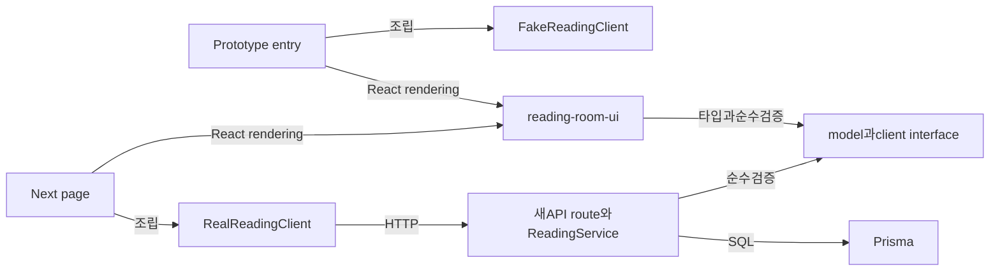

# 패키지 구성 — TO-BE

> DATE2026.10.25 · C-01~08 제안. [핵심](../system-design-to-be.md) · [실행 구성](system-configuration.md) · [원본 패키지](../../as-is/details/package-configuration.md)

## 소스 책임과 공개 접점

```text
apps/
  web/                       기존 Next.js 제품
    pages/reading-room.tsx   제안: 실제 session과 UI 조립
    pages/api/v1/reading-links/index.ts  제안: private list route
    pages/api/v1/links/[id]/reading.ts   제안: private get/put route
    lib/api/controllers/reading.ts      제안: snapshot/CAS 소유
    lib/api/readingPolicy.ts            제안: 접근 predicate
    lib/reading-room/realClient.ts      제안: HTTP timeout adapter
    lib/reading-room/navigation.ts      제안: Next/history/return hint
  reading-room-prototype/    제안: 독립 Vite entry와 fake fixture
    src/fakeClient.ts         제안: 결정적 지연·실패·충돌,API없음
    public/__review/mobile.html 제안: 검토전용390px wrapper
  worker/                    원본 보존·poll 유지
packages/
  reading-room-ui/            제안: 순수 React UI·controller·model·client interface
  prisma/                    기존 schema에ReadingProgress additive migration
  router/                    기존 auth/link/collections hook 유지
  lib/                       기존 safeFetch/files·공유helper 유지
docs/                        stage index·design·verification·최종screenshots
scripts/                     제안: 격리기동/종료·HTTP/DB 계약검증
```

tree는 제안이다. 구현되지 않은 파일을 실제 소스 근거로 인용하지 않는다. 보존 viewer/navbar와 AuthRedirect/Sidebar는 원본 경로에서 최소 수정하며 별도 복제하지 않는다.

## 의존 방향



model은 React/Next/Prisma/Node 전용 import를 하지 않는다. UI는 HTTP endpoint나 NextAuth를 모른다. Fake는 Real을 import하거나 실패 시 fetch로 우회하지 않는다. prototype bundle에 `_app`, SessionProvider, useConfig, useInitialData, Prisma, process.env secret이 들어가면 gate 실패다. 실제 web은 기존 초기 auth/config query를 유지한다.

공유 UI는 React19와 기존 Yarn4 workspace 안에서 사용한다. 별도 lockfile/package manager로 바꾸지 않는다. 새 Vite 의존은 필요한 workspace에만 추가하며 focused install이 가능하면 web/worker/shared/prototype만 설치한다. mobile/extension 개발 의존까지 설치할 이유는 없다. CSS는 reading-room namespace를 사용하고 기존 auth/viewer 스타일을 침범하지 않는다.

## 검증 위치와 작업 맥락

| 영역 | 제안 검증 위치 | 범위 |
|---|---|---|
| 순수model/Controller | UI 옆 의미있는unit/fixture tests | 입력경계·역순응답·초안/목적지보존·CASconflict소비 |
| realClient | web lib 옆transport test | timeout·cancel·nonJSON·오류메시지·POST자동 retry없음 |
| API/DB | scripts/verify-reading-contracts | 실제 session/bearerHTTP와SQL row/privacy/unique/cascade/snapshot |
| prototype | build 산출물+audit 기록 | 독립entry·CSP·의존·CUA상태·시각결정 |
| final | docs/verification 및 docs/screenshots | 실제 원본 계약·browserdesktop/mobile·원본대비변경 |

implementation은 TO-BE gate 뒤 frontend-prototype-prompt, 다음 verify-first-implementation-prompt 순서로 진행한다. staged commit은 prototype/real contracts/integration/final docs를 분리하고 실제 commit hash를 doc index에 연결한다. 테스트 이름이나 명령을 지금 실행했다고 기록하지 않는다.
