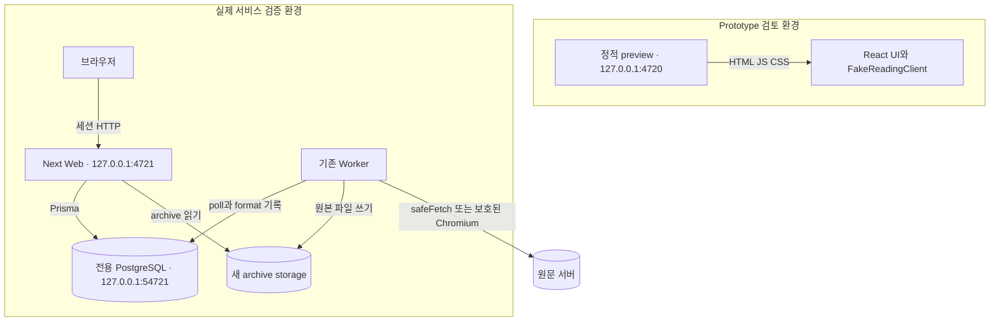

# 실행 구성 — TO-BE

> DATE2026.10.25 · C-01~08 제안. [핵심](../system-design-to-be.md) · [패키지](package-configuration.md) · [원본 구성](../../as-is/details/system-configuration.md)

## 실행 단위와 통신

prototype은 build 후 preview/static server로 실행한다. CSP `connect-src 'none'`에서 dev HMR websocket 오류가 생기지 않도록 개발 HMR을 평가에 쓰지 않는다. HTTP는 정적 파일 전달뿐이며 업무 API/DB/auth가 없다. fixture state는 browser 메모리이고 reset으로 결정적으로 초기화한다. `/__review/mobile.html`은390px iframe 검토 도구이며 실제 제품 업무 route가 아니다.

실서비스는 원본 Next/Worker/PostgreSQL 경계를 유지한다. 새 ReadingProgress table은 원본 DB에 추가되지만 Worker는 접근하지 않는다. Next의 list/get/put가 인증·권한·snapshot·CAS를 처리하고 frontend가 직접 SQL을 실행하지 않는다. root renderer와 CUA는 개발 도구이며 제품 배포 구성에 포함하지 않는다.

## 기동·종료·수명

| 단위 | 기동·수명 제안 | 실패와 종료 책임 |
|---|---|---|
| DB | 새 task 전용 container/volume, loopback54721 | 실행스크립트가소유자원만stop,기존container/volume불변 |
| Next | 외부env를읽고generate/migrate후build/start4721 | PID기록과별도log,종료스크립트가자기PID만중지 |
| Worker | 같은DB와같은archive경로,원본worker entry | 원본poll/finally/retry특성유지. DB와파일성공을합쳐추정하지않음 |
| Prototype | 별도build/static4720,realenv불필요 | 종료해도DB/worker영향없음 |

원본 local storage는 cwd와 경로 정규화 영향을 받으므로 실제 시작 단계에서 web/worker의 동일 경로를 파일 쓰기/읽기로 증명한다. 절대 경로를 storage 값에 넣었는데 repo 하위 상대경로가 생기는 문제를 피하려고 실행 cwd와 source helper를 먼저 대조하고, 생성 archive는 git tree 밖으로 둔다. 이 내용은 아직 실행 사실이 아니라 verify-first 전제다.

## 보안·재현·관찰

secret은 repo 밖0600 env/credential 파일에만 둔다. README에는 env의 이름과 새 자원 생성·run/stop 명령을 쓰고 개발자 개인 절대 경로를 요구하지 않는다. 현재 검증 예정 포트는4720/4721/54721이며 일반 사용자 실행은 환경변수로 바꿀 수 있다. 실제로그에는 password/token을출력하지않고 HTTP검증결과도식별값·상태만보존한다. 원본AGPL/license/attribution은유지한다.

SMTP/SSO/S3/원격browser/content host는 원본 선택 설정이며 이번 기본 loopback 검증에 자동 추가하지 않는다. 실제 구성하지 않은 기능은 최종 문서에서 미검증으로 분리한다. 원문 보존의 형식별 결과는 파일과HTTP로 각각 확인하고 일부 성공을 전체 보존 성공으로 표시하지 않는다.
