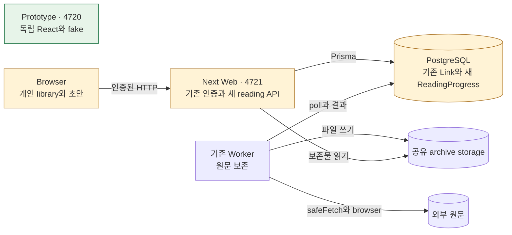

# Reading Room — TO-BE 시스템 설계서

> **DATE** 2026.10.25 · **기준 커밋** `952ac454`(2026-09-09T20:12:04-04:00·upstream PR1834), 애플리케이션 작업 트리 변경 없음
> **범위** 웹 인증·개인 링크 탐색·저장·상세·보존 읽기에 private status/reflection을 추가한다. 원본 공유·공개·보존·주석은 유지하며 별도 관리 업무와 native 플랫폼은 제외한다.
> **근거** 전체 AS-IS 소스 게이트 `21001b7c`·`4703808c` → [근거 브리프](../_evidence-brief.md), [상세 색인](#8-상세근거-인덱스와-한계)
> **표기** 구조 Mermaid, 협력 jobflow, 수명 state, 이동 navigation, 배치 layout. 원본 문법은 project-guides의 각 전용 가이드다.
> **원칙** 신규 경로·심볼은 제안이다. C의 상태는 설계 반영 여부이며 구현·실행 완료가 아니다.
> **공통 한계** 새 서비스·DB·worker·브라우저는 아직 실행하지 않았다. 삭제된 이전 작업의 코드·DB·증거를 재사용하지 않는다.
> **설계 유형** 기존 시스템 개선 — Linkwarden의 저장·보존·공유를 유지하고 개인 독서 흐름을 추가한다.
> **입력 근거** 아래 U-01~05와 [AS-IS](../as-is/system-design-as-is.md)(DATE2026.10.25·952ac454)

입력 요구는 사용자 요청과 부모가 전달한 위임 범위를 다음과 같이 번호로 고정한다.

| 입력 | 요청·제약 |
|---|---|
| U-01 | “개인 읽기 상태 Unread/Reading/Finished와 한 줄 감상을 저장한 링크에 제공하고 Linkwarden 저장·원문 보존·공유를 유지한다.” |
| U-02 | “AS-IS가 내부 코드 JobFlow 의도와 다르면 종속 단계를 중단하고 가이드·프롬프트 수정→재분석→재검토한다.” |
| U-03 | “React 프런트엔드 전용 프로토타입을 제품 수준으로 만들고 실제 개발자 평가 후 최종 디자인을 결정한다. 자율 판단하며 사용자 승인 질문은 하지 않는다.” |
| U-04 | “실제 원본 backend 계약을 먼저 검증하고 최종 제품을 통합한다. 원본 대비 변경·단계 요구/검토/수정/증거/커밋과 실제 screenshots를 남긴다.” |
| U-05 | “새 fork와 새 전용 자원만 사용하고 기존 데이터는 건드리지 않는다. 단계별 Ryu 계정 커밋·push, 원본 라이선스를 보존한다.” |

## 0. 한눈에 보기 — 링크를 모으는 곳에서 다시 읽는 곳으로



**범례**: 녹색은 신규 독립 프로토타입, 노란색은 변경 경계, 기본색은 유지다. prototype에는 업무 서버·DB 연결선이 없다.

**요지**

- 공유 설명과 주석에 개인 감상을 섞지 않고 user+link별 기록을 둔다. 읽기 권한이 있는 회원은 자기 기록만 쓴다(R-01).
- 상태와 한 줄을 한 번에 저장하고, version 충돌·timeout·뒤로가기에서 초안이 사라지지 않게 한다(R-03·R-04).
- 원본 링크 저장200과 worker 보존 완료를 구분하고 실제 원문 viewer를 유지한다(R-05).
- 정수 범위·동시 갱신·history 연동은 실제 계약과 브라우저 검사로 확인한다. 현재는 설계 제안이며 runtime 완료가 아니다(R-07).

## 1. 핵심 용어

기존 용어는 [AS-IS §1](../as-is/system-design-as-is.md#1-핵심-용어)을 유지한다.

| 용어 | 뜻 | 원본 |
|---|---|---|
| ReadingProgress | user+link에만 속하는 status/reflection/version row | [API 데이터](details/web-api.md#4-소유-상태데이터) |
| absence Unread | row가 없을 때 Unread·빈감상·version0으로 읽는 규칙 | [API 계약](details/web-api.md#2-공개-계약) |
| CAS | 읽은 version과 같은 row만 조건부 갱신하는 비교 후 쓰기 | [API JF-3.1](details/web-api.md#jf-31-version-쓰기--commitreading) |
| snapshot | 한 읽기 transaction에서 같은 시점의 DB 값을 보는 기준 | [API JF-1.1](details/web-api.md#jf-11-같은-snapshot의-목록과-개수--listreadinglinks) |
| dirty draft | 저장된 base와 다른 로컬 status/reflection | [Browser 상태](details/browser.md#4-소유-상태데이터) |
| epoch | 늦은 응답이 현재 선택을 덮지 못하도록 비교하는 요청 번호 | [Browser JF-1](details/browser.md#jf-1-library와-선택--loadshelfselectlink) |

## 2. 기능·요구 — 무엇을 해주고 왜 바꾸나

**결론**: 원본의 공유 자산을 유지하면서 개인 독서 판단과 한 줄 기록을 별도 소유권으로 추가한다.

### 2.1 사용자·업무 결과

| 사용자·업무 결과 | 트리거 | 책임 경계 | 요구 | AS-IS 대비 |
|---|---|---|---|---|
| 자기 library를 상태별로 다시 찾음 | 진입·검색·shelf 선택 | Browser/API | R-01·02 | 신규 |
| 상태와 한 줄을 함께 저장 | detail Save | Browser/API/DB | R-03·04 | 신규 |
| 저장·공유·실제 원문 읽기 | URL 저장·viewer 열기 | 기존 API/Worker | R-05 | 유지 |
| 로그인 후 독서실 진입·viewer 왕복 | 인증·Back | Browser | R-05·06 | 변경 |
| 실패·이탈 중 초안 복구 | timeout·409·Back | Browser | R-04 | 신규 |

### 2.2 요구

| R-ID | 필요한 기능/해결할 문제 | 근거 | 성공 기준 | 우선순위 |
|---|---|---|---|---|
| R-01 | user+link 개인 기록과 접근 경계 | U-01, AS-IS A-09, 검토 privacy 반례 | 타인/public JSON에 감상 없음, read-only 회원 자기PUT200, revoke404 | 필수 |
| R-02 | 탐색·상태별 counts·검색·pagination | U-01 | 같은 snapshot 합계,30개 id cursor, 검색과 global counts의 의미 일치 | 필수 |
| R-03 | status와 한 줄의 원자 저장 | U-01 | 한 PUT으로 두 값·version 함께 저장, reload 지속 | 필수 |
| R-04 | 동시 수정·응답 유실·이탈의 손실 방지 | 시나리오에서 발견, U-03 | CAS409, 동일값확인200,15초timeout,Guard가draft·목적지 유지 | 필수 |
| R-05 | 원본 인증·저장·공유·보존 실제 연결 | U-01·04 | 실제POST/DB/worker파일/viewer, 올바른return hint | 필수 |
| R-06 | 판단 가능한 editorial UX와 fake-only prototype | U-03 | 독립build·CSP·bundle audit, desktop/mobile 실브라우저 상태검토 | 필수 |
| R-07 | fresh 자원·재현·단계 증거·라이선스 | U-02·04·05 | migration/검증명령·리뷰수정·커밋·최종screenshots 연결 | 필수 |

### 2.3 설계 항목

| C-ID | AS-IS 대비 | 무엇을 설계하나 | 근거 요구·이슈 | 소유 경계 | 상태 | 상세 |
|---|---|---|---|---|---|---|
| C-01 | 신규 | ReadingProgress 모델·validation·DTO | R-01·03, A-09 | API/DB | 반영 | [API §2/4](details/web-api.md#2-공개-계약) |
| C-02 | 신규 | 접근·snapshot·GET/PUT·CAS | R-01·02·03·04 | API | 반영 | [API 내부](details/web-api.md#3-내부-job-flow--드릴다운) |
| C-03 | 신규 | library/detail/save UI와 timeout adapter | R-02·03·04·06 | Browser | 반영 | [Browser](details/browser.md) |
| C-04 | 신규 | dirty guard·history·conflict 복구 | R-04 | Browser | 반영 | [이탈](details/jobflow/leave-draft.md) |
| C-05 | 변경 | 새저장 UI에서 원본 POST await, 기존API/worker 회귀 | R-05, B-01·A-02 | Browser/API/Worker | 반영 | [새링크](details/jobflow/save-reading-link.md) |
| C-06 | 변경 | 인증 기본목적지·Sidebar·안전한 viewer 복귀 | R-05·06 | Browser | 반영 | [Browser JF-5/6](details/browser.md#jf-5-원본-viewer-왕복--safereadingreturnto) |
| C-07 | 신규 | 독립fake entry·fixture·검토 wrapper | R-06·07 | Prototype | 반영 | [패키지](details/package-configuration.md) |
| C-08 | 신규 | 격리기동·실계약·추적문서·캡처 | R-07 | 통합 | 반영 | [§9](#9-구현검증이행) |

### 2.4 주요 결정

#### D-01 개인 기록의 소유 경계

| 대안 | 장점 | 단점 | 판단 |
|---|---|---|---|
| 공유 Link.description/tag에 저장 | 이행 비용: schema 변경 작음 | 응집:공유와개인소유충돌, 공개노출 | 기각 |
| 기존 DB의 별도 user+link 모델/API | 응집:개인권한·수명이한곳, 검증:실제FK/CAS가능 | 작업 맥락:새route/migration필요 | 선택 |
| 별도 독서 서버·DB | 배포 경계:독립 운영 | 이행/운영 비용:인증·권한동기화연결증가 | 기각 |

- 선택: ReadingService만 ReadingProgress를 쓴다. 원본 Link와 동일 DB에서 cascade한다.
- 근거: 공유 정보와 개인 정보를 분리하면서 기존 인증/권한을 재사용하는 최소 구조다.
- AS-IS 대비: 모델·endpoint 신규, 기존 public response와 worker 무변경.

#### D-02 정합성과 동시 수정

| 대안 | 장점 | 단점 | 판단 |
|---|---|---|---|
| 무조건 upsert·별도 count queries | 작업 맥락:간단 | 검증:조용한lost update·count모순 | 기각 |
| CAS+unique, 목록 RepeatableRead | 응집:쓰기충돌과읽기snapshot책임명확 | 작업 맥락:409/기록없는첫쓰기분기필요 | 선택 |
| 모든 요청 serializable+idempotency ledger | 검증:더강한순서/이력모델 | 운영 비용:retry·ledger청소·불필요한보장 | 기각 |

- 선택: expectedVersion과 compound unique로 상태/한 줄을 함께 저장한다. 같은 payload200은 현재값 확인이다.
- 근거: 두 탭·유실에서 사용자 초안을 보존할 수 있고 독립 exactly-once 요청 보장은 필요하지 않다.
- AS-IS 대비: 개인 기록에만 적용. 기존 공유/파일 쓰기의 원자성을 확대 주장하지 않는다.

#### D-03 UI와 프로토타입 분리

| 대안 | 장점 | 단점 | 판단 |
|---|---|---|---|
| 기존 Next page에 fake flag | 작업 맥락:진입점하나 | 검증:_app/session/config의실제초기요청혼입 | 기각 |
| 순수 React UI+client interface, 별도 Vite entry | 의존 방향:fake/real 조립분리,검증:동일presentation | 작업 맥락:entry2개관리 | 선택 |
| 독립mock HTML을나중에재작성 | 초기 비용:빠름 | 응집:상태/레이아웃차이,실제결정에부족 | 기각 |

- 선택: packages/reading-room-ui를 prototype과 real page가 조립한다. prototype build는 connect-src none이다.
- 근거: 제품 수준의 동작·시각을 서버 없이 평가하고 이후 실제 transport만 연결한다.
- AS-IS 대비: 기존 전체 Next app을 복제하지 않고 필요한 새 독서 UI만 분리한다.

#### D-04 초안 이탈과 충돌의 사용자 판단

| 대안 | 장점 | 단점 | 판단 |
|---|---|---|---|
| 클릭마다 즉시 저장 | 입력 수:Save불필요 | 응집:상태/글각각실패·중간문장쓰기 | 기각 |
| 한 Save와guard, 충돌을명시 | 검증:원자적초안·실패 복구확인가능 | 조작 비용:Save선택필요 | 선택 |
| 로컬저장소에자동영구draft | 복구:탭종료후가능 | privacy:계정전환·공용기기수명관리증가 | 이번범위기각 |

- 선택: 메모리 draft, Save/Discard/KeepEditing, timeout과409 안내. unknown Next history는 제한된 URL 복원 fallback을 둔다.
- 근거: 서버 저장 여부와 이동 여부를 사용자가 이해할 수 있게 하고 background overwrite를 피한다.
- AS-IS 대비: 새로운 Reading Room 흐름에 적용하며 기존 모든 편집창을 재작성하지 않는다.

## 3. 구조 — 무엇으로 이뤄져 있나

**결론**: 실제 배포 경계는 유지하며 순수 UI 패키지와 개인 기록 API만 추가한다.

| 경계 | 포트·형태 | 한 줄 책임 | 공개 진입점 | 소유 상태 | 나가는 의존 | AS-IS 대비 |
|---|---|---|---|---|---|---|
| Browser | React | 개인 library와 draft | ReadingRoomApp | 초안·선택·목적지 | ReadingClient·기존auth | 변경 |
| Web API | :4721 | 기존 계약과 private reading | HTTP routes | DB 쓰기 정책 | verifyUser·Prisma | 변경 |
| PostgreSQL | :54721 | 영속 데이터 | SQL | Link/User/ReadingProgress | 없음 | 변경 |
| Worker/파일·원문 adapter | 별도 Node process | 원본 보존 | poll worker entry | 일시 보존 실행 | DB·filesystem·safe network | 유지 |
| Prototype | :4720 정적 SPA | 서버 없는 상태와 React 시각 | index entry | 메모리 fixture | pure UI만 | 신규 |

### 3.1 의존 방향에서 드러나는 사실

**결론**: fake와 real은 같은 UI의 바깥에서 조립하며 Worker는 개인 기록을 알지 못한다.

[시스템 구성](details/system-configuration.md)과 [패키지 구성](details/package-configuration.md)이 기동·의존·원본 유지 경계를 상세히 설명한다.

## 4. 경계별 기능 목록 — 각 경계가 무엇을 하나

**결론**: 개인 기록은 새 API가 단일 쓰기 책임을 갖고, 보존은 기존 Worker가 계속 담당한다.

### 4.1 Browser (React)

| 기능 | 내용 | 진입점 | AS-IS 대비 | C-ID |
|---|---|---|---|---|
| library/detail/draft/guard | [Browser 계약](details/browser.md#2-공개-계약) | ReadingRoomApp | 신규 | C-03·04 |
| 기본진입/viewer복귀 | [JF-5/6](details/browser.md#jf-5-원본-viewer-왕복--safereadingreturnto) | AuthRedirect/PreservationNavbar | 변경 | C-06 |
| 기존 auth/list/share/tools | [AS-IS Browser](../as-is/details/browser.md) | 원본 pages/hooks | 유지 | C-05 |

### 4.2 Web API :4721

| 기능 | 내용 | 진입점 | AS-IS 대비 | C-ID |
|---|---|---|---|---|
| 개인 기록 | [API 공개 계약](details/web-api.md#2-공개-계약) | reading-links,links/:id/reading | 신규 | C-01·02 |
| 기존 인증/링크/공유/보존 | [AS-IS API](../as-is/details/web-api.md) | 원본 routes | 유지 | C-05 |

### 4.3 PostgreSQL :54721

| 기능 | 내용 | 진입점 | AS-IS 대비 | C-ID |
|---|---|---|---|---|
| 개인 row | unique pair·FK·version·snapshot | Prisma/SQL | 신규 | C-01·02 |
| 기존 row | User/Link/collection/format | 기존 Prisma | 유지 | C-05 |

### 4.4 Worker와 Adapter (Node)

[AS-IS Worker](../as-is/details/worker.md)와 [Adapter](../as-is/details/adapters.md)의 기능을 유지한다. ReadingProgress를 읽거나 쓰지 않으며 보존 성공을 Finished로 자동 전환하지 않는다.

### 4.5 Prototype (정적 SPA)

| 기능 | 내용 | 진입점 | AS-IS 대비 | C-ID |
|---|---|---|---|---|
| fake 상태 | 결정적 fixture·실패·충돌·초기화 | Vite entry/FakeReadingClient | 신규 | C-07 |
| 시각 판단 | 독립 UI·CSP·mobile wrapper | build preview | 신규 | C-07·08 |

## 5. 흐름 — 경계끼리 어떻게 소통하나

**결론**: 사용자의 읽기·저장 요청은 API 응답으로 완료하고, 원문 보존은 별도 worker poll로 완료한다. 초안의 timeout은 실패 안내와 보존으로 복구한다.

### 5.0 표기

| 객체 | 경계 | 객체 | 경계 |
|---|---|---|---|
| Browser | UI·응답 다음동작 | API | 인증·업무 HTTP |
| Worker | 별도 보존실행 | DB/Files/Origin | 저장소·원문 외부경계 |

상위 그림의 묶음은5.1에만 쓴다. 내부 실제/제안 함수 호출은 상세 JF에서 펼친다.

### 5.1 전체 한 장

```jobflow
scope: reading_room_overview
Object: Browser, API, Worker, DB, Files, Origin
Browser.readAndRecord --> API.personalReading
API.personalReading --> DB.personalRows
API.personalReading.result --> Browser.showLibrary
Worker.pollAndPreserve --> DB.pendingLinks
Worker.pollAndPreserve --> Origin.read
Worker.pollAndPreserve --> Files.writeArchive
Worker.pollAndPreserve --> DB.recordFormats
```

**읽는 법**: Browser.readAndRecord/API.personalReading은 list/get/put 묶음이며 §5.20/21에서 나눈다. Worker는 HTTP의 후속 호출이 아닌 별도 실행이다. DB.personalRows는 새 개인 조회와 쓰기를 뜻한다. worker 묶음은 원본 selector와 형식별 보존으로 §5.16에서 펼친다. 가입·로그인·공유·삭제·보존 파일 읽기는 아래 색인에 유지한다.

| § | 시나리오 | 트리거 | 완료 사실 | Job Flow | Navigation | AS-IS 대비 |
|---|---|---|---|---|---|---|
| [5.2](#52-링크-저장) | 링크 저장 | NewLink Create | DB link 생성과200응답; 보존은 미완료 | [save-link](details/jobflow/save-link.md) | [save-link](details/navigation/save-link.md) | 유지 |
| [5.3](#53-로그인과-기본-진입) | 로그인과 기본 진입 | 비인증 사용자가 Login의 credentials form을 제출 | JWT session을 받은 뒤 AuthRedirect가 공개/구독/onboarding/보호 경로 조건에 맞는 화면을 표시 | [access](details/jobflow/access.md) | [access](details/navigation/access.md) | 변경 |
| [5.4](#54-회원-가입) | 회원 가입 | Register의 Sign up form 제출 | User와 기본 dashboard sections가 생성되고 email설정에 따라 confirmation 또는 login으로 이동 | [register](details/jobflow/register.md) | [register](details/navigation/register.md) | 유지 |
| [5.5](#55-재설정-이메일-요청) | 재설정 이메일 요청 | Forgot form에 이메일을 넣고 Send reset link 클릭 | 200을 받은 UI가 sent 안내를 표시; SMTP 전달 완료는 이 응답의 보장이 아님 | [request-reset](details/jobflow/request-reset.md) | [request-reset](details/navigation/request-reset.md) | 유지 |
| [5.6](#56-재설정-토큰-소비) | 재설정 토큰 소비 | 메일의 `/auth/reset-password?token=...`에서 새 비밀번호 제출 | User.password가 갱신되고 token만료 처리 뒤 UI에 성공 문구와 Login 링크 표시 | [reset-password](details/jobflow/reset-password.md) | [reset-password](details/navigation/reset-password.md) | 유지 |
| [5.7](#57-목록검색대시보드-조회) | 목록·검색·대시보드 조회 | 보호 목록/검색/collection route 진입 또는 sort/filter/스크롤 변화 | 허용 collection의 link page가 표시되고 nextCursor가 있으면 추가 페이지를 가져온다 | [browse-links](details/jobflow/browse-links.md) | [browse-links](details/navigation/browse-links.md) | 유지 |
| [5.8](#58-링크-상세-조회) | 링크 상세 조회 | 카드의 info를 누르거나 `/links/[id]` 직접 진입 | 허용된 link의 제목·공유 description/tags·보존 형식이 상세 page/drawer에 표시 | [inspect-link](details/jobflow/inspect-link.md) | [inspect-link](details/navigation/inspect-link.md) | 유지 |
| [5.9](#59-링크-편집) | 링크 편집 | 권한 있는 사용자가 LinkDrawer Edit에서 필드를 바꾸고 Save | DB link metadata가 갱신되고 query가 무효화된다. UI는 요청 완료 전에 view로 전환 | [edit-link](details/jobflow/edit-link.md) | [edit-link](details/navigation/edit-link.md) | 유지 |
| [5.10](#510-링크-삭제) | 링크 삭제 | Delete confirmation의 Delete 또는 권한 있는 메뉴에서 Shift+Delete | DB link가 삭제되고 cache에서 제거된다. 파일 삭제 완료는200의 보장이 아님 | [delete-link](details/jobflow/delete-link.md) | [delete-link](details/navigation/delete-link.md) | 유지 |
| [5.11](#511-컬렉션-공개회원-권한-변경) | 컬렉션 공개·회원 권한 변경 | 컬렉션 owner가 Sharing dialog에서 공개/회원/역할을 바꾸고 Save | 공개 flag와 root 회원 관계가 저장되고 dialog가 닫힌다. 선택하면 하위 회원관계도 순차 변경 | [share-collection](details/jobflow/share-collection.md) | [share-collection](details/navigation/share-collection.md) | 유지 |
| [5.12](#512-공개-링크와-컬렉션-읽기) | 공개 링크와 컬렉션 읽기 | 공유 `/public/collections/:id` 또는 `/public/links/:id` URL 직접 진입 | isPublic collection에 속한 link 목록·상세와 공개 team정보 표시 | [view-public](details/jobflow/view-public.md) | [view-public](details/navigation/view-public.md) | 유지 |
| [5.13](#513-보존-다시-생성-요청) | 보존 다시 생성 요청 | LinkDrawer/Preserved 메뉴에서 Refresh 확인 | format/lastPreserved가 null로 reset되어 worker poll 대상이 된다; 아직 파일 재생성 완료가 아님 | [refresh-preservation](details/jobflow/refresh-preservation.md) | [refresh-preservation](details/navigation/refresh-preservation.md) | 유지 |
| [5.14](#514-선택-범위-highlight주석) | 선택 범위 highlight·주석 | Readable에서 텍스트 선택 후 색상/댓글 저장 또는 주석 삭제 | 개인 user/link/offset 주석이 저장되고 해당 highlight cache와 DOM표시 갱신 | [highlight](details/jobflow/highlight.md) | [highlight](details/navigation/highlight.md) | 유지 |
| [5.15](#515-보존물-읽기) | 보존물 읽기 | 상세에서 형식을 선택하거나 preserved URL 직접진입 | 형식별 파일이 iframe/img/Readable 본문에 표시 | [read-preserved](details/jobflow/read-preserved.md) | [read-preserved](details/navigation/read-preserved.md) | 변경 |
| [5.16](#516-백그라운드-보존) | 백그라운드 보존 | worker poll에서 lastPreserved=null link 선택 | format path 또는 unavailable와 lastPreserved 기록 | [preserve-link](details/jobflow/preserve-link.md) | [preserve-link](details/navigation/preserve-link.md) | 유지 |
| [5.17](#517-메일-인증-링크-소비) | 메일 인증 링크 소비 | 메일 URL 열기 | web callback 또는 native 선택 UI | [Job Flow](details/jobflow/verify-email-link.md) | [Navigation](details/navigation/verify-email-link.md) | 변경 |
| [5.18](#518-화면-초기-데이터-읽기) | 화면 초기 데이터 읽기 | 각 hook mount | user/config/collections cache와 가드 입력 | [Job Flow](details/jobflow/initial-data.md) | [Navigation](details/navigation/initial-data.md) | 유지 |
| [5.19](#519-보존-본문-표시-설정) | 보존 본문 표시 설정 | TextStyle 선택 | User preference와 reader 표시 | [Job Flow](details/jobflow/reader-preference.md) | [Navigation](details/navigation/reader-preference.md) | 유지 |
| [5.20](#520-개인-library-읽기) | 개인 library 읽기 | 진입·shelf·검색·선택 | 자기상태가포함된목록과상세표시 | [Job Flow](details/jobflow/reading-library.md) | [Navigation](details/navigation/reading-library.md) | 신규 |
| [5.21](#521-개인-상태와-한-줄-저장) | 개인 상태와 한 줄 저장 | detail Save | status/reflection/version저장또는명시충돌 | [Job Flow](details/jobflow/save-reading.md) | [Navigation](details/navigation/save-reading.md) | 신규 |
| [5.22](#522-초안이-있는-화면-이탈) | 초안이 있는 화면 이탈 | dirty상태이동·Back | 선택한저장/버리기/계속편집완료 | [Job Flow](details/jobflow/leave-draft.md) | [Navigation](details/navigation/leave-draft.md) | 신규 |
| [5.23](#523-reading-room에서-새-링크-저장) | Reading Room에서 새 링크 저장 | 새저장overlay제출 | 원본 POST200의실제id상세 | [Job Flow](details/jobflow/save-reading-link.md) | [Navigation](details/navigation/save-reading-link.md) | 신규 |

### 5.2 링크 저장

Create는 요청을 시작한 뒤 바로 창을 닫는다. API의 200은 링크 저장 완료이며 보존 완료는 아니다. [Job Flow](details/jobflow/save-link.md) · [Navigation](details/navigation/save-link.md)

### 5.3 로그인과 기본 진입

로그인 성공 후 AuthRedirect가 세션과 구독·이름·현재 경로를 판단하고, 일반 기본 진입은 Reading Room으로 바뀐다(C-06). 이메일 미인증은 메일 안내로 분기하고, 원래 보호 URL을 보존하는 복귀 인자는 없다. [Job Flow](details/jobflow/access.md) · [Navigation](details/navigation/access.md)

### 5.4 회원 가입

가입은 User와 기본 dashboard sections를 생성한다. 중복·등록 차단 오류는 폼에 남고, 성공하면 이메일 설정에 따라 Confirmation 또는 Login으로 이동한다. [Job Flow](details/jobflow/register.md) · [Navigation](details/navigation/register.md)

### 5.5 재설정 이메일 요청

재설정 요청의 200은 UI를 발송 안내로 바꾸지만 실제 SMTP 전달을 기다리지는 않는다. 사용자 조회·요청 빈도·token 생성과 발송 실패를 구분한다. [Job Flow](details/jobflow/request-reset.md) · [Navigation](details/navigation/request-reset.md)

### 5.6 재설정 토큰 소비

유효한 token으로 비밀번호를 바꾸고 token을 만료 처리한다. 이 쓰기들은 별도 query이므로 부분 실패가 가능하다. [Job Flow](details/jobflow/reset-password.md) · [Navigation](details/navigation/reset-password.md)

### 5.7 목록·검색·대시보드 조회

목록·검색·태그·대시보드는 각 query 결과를 표시한다. Meili 검색에서도 DB 권한을 다시 확인하며, offset cursor와 DB id cursor는 서로 다르다. [Job Flow](details/jobflow/browse-links.md) · [Navigation](details/navigation/browse-links.md)

### 5.8 링크 상세 조회

상세는 owner 또는 회원의 접근을 확인한 뒤 공유 정보와 보존 형식을 보여 준다. 읽기 허용이 편집·삭제 허용을 뜻하지 않는다. [Job Flow](details/jobflow/inspect-link.md) · [Navigation](details/navigation/inspect-link.md)

### 5.9 링크 편집

편집 창은 서버 응답을 기다리지 않고 보기 모드로 돌아간다. URL 변경 때 파일 제거가 DB 갱신보다 먼저 일어나는 점도 실패 결과에 영향을 준다. [Job Flow](details/jobflow/edit-link.md) · [Navigation](details/navigation/edit-link.md)

### 5.10 링크 삭제

삭제는 DB row를 먼저 지우고 파일 제거를 요청한다. HTTP 성공은 local unlink callback 완료를 보장하지 않는다. [Job Flow](details/jobflow/delete-link.md) · [Navigation](details/navigation/delete-link.md)

### 5.11 컬렉션 공개·회원 권한 변경

owner가 공개 여부와 회원 권한을 저장하며, 선택하면 하위 컬렉션으로 전파한다. transaction callback 안의 전역 Prisma 호출을 단일 원자적 쓰기로 해석하지 않는다. [Job Flow](details/jobflow/share-collection.md) · [Navigation](details/navigation/share-collection.md)

### 5.12 공개 링크와 컬렉션 읽기

공개 metadata·목록·상세는 서로 다른 GET 계약이다. collection의 공개 조건을 각 요청에서 확인하며, 공유 해제 뒤 이미 발급된 파일 token은 별도 수명을 갖는다. [Job Flow](details/jobflow/view-public.md) · [Navigation](details/navigation/view-public.md)

### 5.13 보존 다시 생성 요청

Refresh는 보존 필드와 marker를 비우고 기존 파일을 제거하여 다음 worker 선택 대상에 넣는다. 재생성 완료를 기다리는 요청은 아니다. [Job Flow](details/jobflow/refresh-preservation.md) · [Navigation](details/navigation/refresh-preservation.md)

### 5.14 선택 범위 highlight·주석

선택한 텍스트의 개인 주석을 읽고 저장·삭제한다. 쓰기는 owner/canUpdate를 요구하지만 조회·삭제는 다른 predicate를 사용한다. [Job Flow](details/jobflow/highlight.md) · [Navigation](details/navigation/highlight.md)

### 5.15 보존물 읽기

보존 형식은 직접 archive GET 또는 별도 host의 서명 URL로 읽는다. 파일·권한 오류, 생성 대기, 형식 unavailable을 구분하며 새 Reading Room의 유효한 return hint가 있으면 해당 상세로 돌아가고, 기존 진입은 Dashboard를 유지한다(C-06). [Job Flow](details/jobflow/read-preserved.md) · [Navigation](details/navigation/read-preserved.md)

### 5.16 백그라운드 보존

worker가 미처리 링크를 선택하고 형식별 파일과 최종 marker를 기록한다. try 안 실패는 marker를 남길 수 있고, try 이전 setup 실패는 같은 finally를 거치지 않는다. [Job Flow](details/jobflow/preserve-link.md) · [Navigation](details/navigation/preserve-link.md)

### 5.17 메일 인증 링크 소비

메일의 `/auth/verify`는 내부 웹 bridge다. 부모 가드가 허용하면 입력·config·모바일 여부를 판단하고 웹 callback 또는 앱 링크 선택으로 이어진다. [Job Flow](details/jobflow/verify-email-link.md) · [Navigation](details/navigation/verify-email-link.md)

### 5.18 화면 초기 데이터 읽기

user·config·collections는 각각 독립 query이며 화면 가드와 저장 입력의 선택지를 만든다. user query와 API 업무 권한 검증을 같은 계약으로 취급하지 않는다. [Job Flow](details/jobflow/initial-data.md) · [Navigation](details/navigation/initial-data.md)

### 5.19 보존 본문 표시 설정

글꼴·크기·행간·폭 선택은 개인 User preference를 즉시 저장한다. 실패 시 낙관적 값을 복원하는 onError가 없는 상태도 기록한다. [Job Flow](details/jobflow/reader-preference.md) · [Navigation](details/navigation/reader-preference.md)

### 5.20 개인 library 읽기

사용자가 shelf·검색·article을 선택하면 API가 접근 가능한 목록과 자기 기록을 반환한다. 목록과 상세는 별도 요청이며 늦은 응답은 현재 선택을 덮지 않는다. 상세는 [Job Flow](details/jobflow/reading-library.md), 사용자 선택과 복귀는 [Navigation](details/navigation/reading-library.md)에 정의한다.

### 5.21 개인 상태와 한 줄 저장

Save는 상태와 한 줄을 함께 쓰고 저장된 version을 반환한다. 충돌이나 결과 불명은 초안을 유지하고 사용자의 다음 선택을 기다린다. 상세는 [Job Flow](details/jobflow/save-reading.md), 사용자 선택과 복귀는 [Navigation](details/navigation/save-reading.md)에 정의한다.

### 5.22 초안이 있는 화면 이탈

닫기·다른 글·filter·Back으로 이동하려 할 때 dirty draft를 확인한다. 저장 성공 또는 명시적 버리기만 보관한 목적지로 이동한다. 상세는 [Job Flow](details/jobflow/leave-draft.md), 사용자 선택과 복귀는 [Navigation](details/navigation/leave-draft.md)에 정의한다.

### 5.23 Reading Room에서 새 링크 저장

새 저장 창은 원본 POST를 기다린다. 성공 후 실제 id의 상세를 열고 보존 대기와 개인 Unread를 별개로 보여 준다. 상세는 [Job Flow](details/jobflow/save-reading-link.md), 사용자 선택과 복귀는 [Navigation](details/navigation/save-reading-link.md)에 정의한다.

### 5.24 경계 내부 Job Flow 드릴다운 색인

모든 시나리오의 상위 노드는 각 파일 §3에서 실제 또는 제안 심볼로 연결한다. 신규 설계의 펼침은 구현 검증 완료를 뜻하지 않는다.

| 경계 | 내부 Job Flow 절 | 그림 수 | 상위 노드 → 대표 하위 그림 |
|---|---|---|---|
| 변경 Browser | [§3](details/browser.md#3-내부-job-flow--드릴다운) | 13 | openShelf→JF-1→JF-1.1, resolveGuard→JF-3→JF-3.1 |
| 변경 API | [§3](details/web-api.md#3-내부-job-flow--드릴다운) | 12 | listReadingLinks→JF-1→JF-1.1,putReading→JF-3→JF-3.1/3.2 |
| 유지 Browser/API | 각목표시나리오§3 → AS-IS상세 | AS-IS167개전체중해당범위 | submitLink→실제NewLinkModal, API.postLink→setCollection/metadata |
| DB/Files/Origin | 외부 SQL·filesystem·원문 계약 | — | API/Worker의 Prisma·file·safeFetch adapter에서 외부 경계로 중단 |
| 유지 Worker/Adapter | [Worker](../as-is/details/worker.md#3-내부-job-flow--드릴다운),[Adapter](../as-is/details/adapters.md#3-내부-job-flow--드릴다운) | 기존원본참조 | pollAndPreserve→getLinkBatchFairly/archiveHandler→각형식/SSRF |

**드릴다운에서 드러난, 상위 그림을 읽을 때 알아야 할 사실**

- API의200과 worker 보존 완료는 서로 다르다. 새 개인 상태 저장은 worker를 호출하지 않는다.
- Snapshot은 실제 tx client를 통한 같은 transaction이며, CAS는 조건부 UPDATE와 unique 제약으로 보장한다.
- 동일 payload의200은 현재 값의 확인이며 독립 요청의 idempotency를 보장하지 않는다.
- index가 없는 Next history는 document 종료와 다르므로 별도 Guard 정책을 사용한다.

## 6. 데이터 — 무엇이 들어오고 남나

### 6.1 입력

**결론**: userId는 인증에서만 얻고, 사용자 입력은 API와 UI가 같은 순수 규칙으로 검사한다.

| 입력 | 출처·신뢰 경계 | 형식·단위 | 검증·누락 처리 | 소유 |
|---|---|---|---|---|
| status/reflection/version | Browser→API | enum,280UTF-16 units,Int32 | unknownkey/개행/범위 초과400 | ReadingService |
| linkId/cursor/query | URL→API | 양의Int32/query≤200 | invalid400,없는link404 | API |
| actor | 기존session/bearer | verifyUser.user.id | unauth거절 | Auth |
| collection/URL | 새Saveoverlay→원본 POST | 원본schema,id또는명시새name | 원본권한·중복·용량 | Link API |
| returnTo | URL→viewer | allowlistedrelativepath/query | invalid은Dashboardfallback | Browser |

### 6.2 권위 소유자와 생명주기

**결론**: 개인 기록의 영속 권위는 API/DB이고 browser draft는 요청자 소유다.

| 데이터 | 권위 소유자 | 저장 | 보존 | 일관성·실패 책임 |
|---|---|---|---|---|
| ReadingProgress | ReadingService | 기존PostgreSQL추가table | user/link삭제cascade,권한 회수는숨김 | unique/CAS,상태와글한쓰기 |
| draft/conflict/destination | Controller | 메모리 | actor변경/명시discard/unmount | Guard·timeout·epoch |
| counts/page | ReadingService | 응답시점snapshot | 요청마다재계산 | RepeatableRead |
| Link/공유/보존/주석 | 기존API/Worker | 원본 DB/files | 기존수명 | 기존부분실패계약유지 |

### 6.3 트랜잭션 경계

**결론**: 기존 데이터를 옮기거나 이중 쓰지 않고 additive migration만 적용한다.

기존 Link는 absence Unread로 읽는다. 기존 public/link serializer는 새 relation을 include하지 않는다. schema 추가→새 API 계약 검증→real UI 연결→auth 기본 전환 순서다. rollback은 새 진입을 해제하고 기존 Dashboard로 되돌리며 개인 table은 보존한다. table을 삭제하는 down migration은 별도 파괴 작업이며 자동 실행하지 않는다.

## 7. 화면 — 사용자는 어디를 오가나

**결론**: 20개 원본 Layout의 구체적 배치와 조건을 유지하고 4개 새 독서 화면을 더한다. 인증 기본진입과 viewer Back은 목표 계약에 맞게 바꾼다.

| 화면 | 주소 | 핵심 상호작용 | 서버 계약 |
|---|---|---|---|
| ReadingLibrary/Detail | /reading-room?link=id | 탐색·단일 Save·원문열기 | reading list/get/put |
| SaveReadingLink/DraftGuard | 주소 없는 overlay | URL저장·초안보호 | 원본 POST/조건부PUT |
| 기존 인증/목록/공개/보존/tools | 원본 route/overlay | 유지 과업,viewer복귀만추가 | 기존 API |

[24개 화면 색인](details/layout/index.md)은 route없는Save/Guard까지포함한다. 원본범위밖관리·구매·native업무는확장하지않는다. 핵심new flow는library→detail→단일 Save와보존viewer왕복이며그중dirty이탈은항상Guard를거친다.

## 8. 상세·근거 인덱스와 한계

| 상세 문서 | 경계 | R·C·D |
|---|---|---|
| [시스템](details/system-configuration.md), [패키지](details/package-configuration.md) | 전체 | C-01~08 |
| [Browser](details/browser.md) | UI·transport | R-02~06/C-03·04·06·07/D-03·04 |
| [API](details/web-api.md) | private API·DB | R-01~04/C-01·02/D-01·02 |
| [Worker](../as-is/details/worker.md), [Adapter](../as-is/details/adapters.md) | 유지 내부 | C-05 |
| [시나리오](#51-전체-한-장), [Layout](details/layout/index.md) | 전체 흐름·화면 | R-01~07 |
| [입력 AS-IS](../as-is/system-design-as-is.md), [브리프](../_evidence-brief.md) | 원본·반례·단계 | 물려받은 B/A/W/S 이슈 |

### 8.1 확인하지 못한 범위

아직 prototype/실제 HTTP/DB/worker/브라우저를 검증하지 않았다. TO-BE 후보의 독립 검토 결과도 준비되는대로 브리프에 구분해 기록한다. local archive만 우선 검증하며 SMTP/SSO/S3/별도 content host는 실제 설정 없으면 미검증으로 남긴다.

## 9. 구현·검증·이행

**결론**: 설계 gate→독립 prototype 결정→실제 계약→통합→실행 증거 순서로 진행하고 각 gate를 commit한다.

### 9.1 독립 작업 순서

| 순서 | 작업(C-ID) | 쓰기 소유 | 완료 기준 | 검증 |
|---|---|---|---|---|
| 1 | C-01~08 TO-BE 확정 | reading_room 문서, root/Critic 읽기검토 | 열린필수 지적0,원본과제안구분 | strict·렌더·의미검토 |
| 2(1후) | C-03·04·07 fake prototype | reading_room UI/prototype | final-like독서실,실제상태·Back검토,개발자 결정 | 독립bundle/CSP·CUA desktop/mobile |
| 3(2후) | C-01·02·08 실제계약 | reading_room schema/API/scripts | 격리DB와실제 HTTP CAS/privacy/cascade검증 | SQL/HTTP/transporttest,UI연결전 |
| 4(3후) | C-05·06 real통합 | reading_room Nextpage/adapter/viewer | 원본save/worker/read/auth왕복 | 실제 브라우저+별도 GET/DB |
| 5(4후) | C-08 최종문서/캡처 | reading_room docs,rootCUA캡처인계 | original-vs-new,요구→지적→변경→증거→commit | build/typecheck/reproduce·gitpush |

### 9.2 검증

| 검증 | 대상 계약·시나리오 | 방법·명령 | 시점 |
|---|---|---|---|
| 문서연결/의미 | 전수L0→L1/L2·scope·UI | design-doc-check --strict,rootrenderer,Critic source/제안검토 | TO-BE gate전 |
| fake독립·UX | 5.20~23,desktop/mobile | Vite build후staticpreview4720,CSPconnectnone,bundleaudit,CUA | 실제API구현 전 |
| DB/HTTP | own/read-only/outsider/revoke/cascade/CAS/counts | 새Postgres54721,migration,privatefixture+verify-script | realUI연결전 |
| transport | timeout·abort·parse·명시retry | 로컬응답지연fixture,짧은테스트timeout | realadapter연결전 |
| Nexthistory | legacyDashboard→ReadingRoom→dirty→Back | 실제PagesRouter,CUA Keep/Discard/실패retry | auth기본전환전 |
| 원본보존 | 새URL→DB→worker→Readable/PDF/image/HTML | 새archive경로,파일/HTTP증거+CUAviewer | 통합검증 |
| 제품완료 | 로그인 기본·savednote재로드·viewerreturn·mobile | fullbuild/typecheck,rootCUA캡처,독립GET | finalgate |

위는 계획이다. 이미 수행한 검토는 브리프의 날짜·실행 명령·범위와 별개다. screenshot viewport는 실제 브라우저 DOM 수치로 기록하고 디자인 목표 폭과 혼동하지 않는다.

### 9.3 이행·롤백

새 전용 loopback 자원을 만들고 기존 DB나 container를 재사용하지 않는다. secret은 repo 밖0600 파일에 두며, repo에는 값이 없는 example과 환경변수로 재현할 수 있는 script를 둔다. migration은 table/enum/relation/index 추가이며 기존 row를 변환하지 않는다. prototype은 실제 DB에 연결하지 않는다. 실제 계약 단계와 통합 단계는 별도 commit으로 남긴다. 새 UI를 꺼도 기존 Linkwarden과 개인 row는 남는다. auth 기본 목적지는 마지막에 Reading Room으로 전환한다.

### 9.4 물려받는 이슈 처분

| AS-IS ID | 처분 | 근거 |
|---|---|---|
| B-01 | C-03/C-05에서새UI만응답await | 기존모든modal재작성은범위밖 |
| A-09 | C-01/C-02로해결 | 개인 상태/감상신규모델 |
| A-02/W-01 | 계약과UX로명시,기존비동기구조유지 | 저장과보존은다른완료 |
| A-05 | 새Policy는조회/판단을명시 | 기존helpercaller조건은유지 |
| A-07 | 보류,원본공유원자성은수정안함 | 새readingtx와분리 |
| A-08 | 유지·검증한계고지 | signedtokenTTL은기존보존계약 |
| A-04/W-03/S-01/S-03와나머지 | 비대상또는회귀관찰 | 원본SMTP/worker/files광범위개선으로확대안함 |

### 9.5 미확정·필요 입력

| 항목 | 잠정안 | 영향 | 필요 입력 |
|---|---|---|---|
| CAS실제오류/경합 | unique+updateMany계약 | 오류모양이다르면adapter수정 | 새Prisma/PostgresHTTPprobe,단계3앞 |
| Nextunknownhistory | beforePopState false+URL복원fallback | stack모양일부변경,초안보호우선 | 실제PagesRouterBack검증,단계4앞 |
| 원본보존실행환경 | localChromium·파일,optionalMonolith별도확인 | 형식별 가용성이다를수있음 | 새worker실행과파일증거 |
| 화면최종시각 | ivory/forest/serifeditorial | typography/공간조정가능 | prototype실브라우저평가와개발자 결정 |

사용자에게 추가 승인 질문을 요구하는 미확정은 없다. 위 항목은 허용된 구현·검증으로 해소하고 결과에 맞게 설계를 갱신한다.
